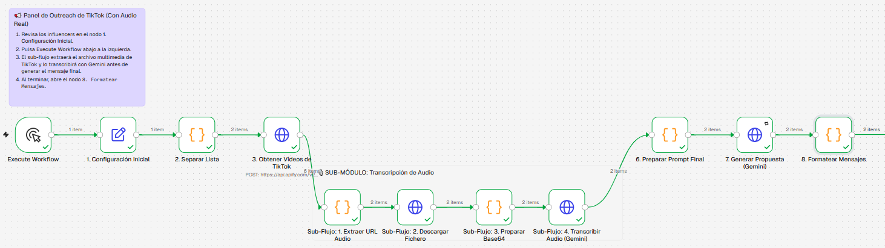
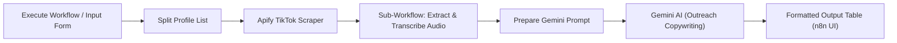

# TikTok AI Outreach & Content Monitor

Automated commercial outreach and content analysis pipeline built on **n8n**, **Apify**, and **Google Gemini AI**. It tracks public TikTok creators, captures their latest video audio, transcribes the speech multimodal-first using Google Gemini, applies anti-sponsorship filtering, and generates personalized commercial outreach messages displayed directly in n8n's visual output.

Operates on free tiers with **no TikTok credentials or business API required**. Cross-platform and containerized for **Windows** and **Linux Fedora**.

---

## What We Want to Achieve

- **Commercial Outreach Pipeline:** Targeted prospecting workflow designed for non-technical marketing teams to connect with financial services creators.
- **Sequential Per-Profile Processing:** Iterate profile-by-profile to handle influencer lists safely, applying automatic retries (mitigating 503 errors).
- **Anti-Sponsorship Filtering:** Exclude sponsored videos (`#publi`, `#ad`, `#sponsor`, etc.) to focus exclusively on organic content.
- **Native Audio Extraction & Transcription:** Retrieve direct audio streams (`musicMeta.playUrl`) with zero extra Apify credit consumption, convert to Base64, and transcribe spoken content via Gemini.
- **Hyper-Personalized Outreach Copywriting:** Synthesize natural sales hooks from real video speech combined with captions, outputs directly into a clean tabular layout inside n8n.



---

## Main Components



1. **Automation Engine:** **n8n** (Community Edition) via Podman / Docker Compose.
2. **TikTok Scraper:** **Apify** (`clockworks~free-tiktok-scraper`).
3. **AI Synthesizer:** **Google Gemini 2.5 Flash**.
4. **Dashboard:** n8n webhook at [http://localhost:5678/webhook/tiktok-feed](http://localhost:5678/webhook/tiktok-feed).

API keys stay in `.env`. Compose injects them into the n8n container; the workflow reads `$env.APIFY_API_TOKEN` and `$env.GEMINI_API_KEY`.

---

## Universal Commands (Windows & Linux Fedora)

### 1. Start n8n

From `tiktok-monitor/`:

> [!IMPORTANT]
> **Windows Users:** If you are using Podman on Windows, make sure the VM is running first by executing `podman machine start` in your terminal before running the compose command. Then, double-check its status with `podman machine list`.

```bash
podman-compose -f deploy/local/compose.yaml --env-file .env up
# or: docker compose -f deploy/local/compose.yaml --env-file .env up
```

`--env-file .env` loads local secrets and passes `APIFY_API_TOKEN` and `GEMINI_API_KEY` into the container.

### 2. Access Web UI

* **n8n:** [http://localhost:5678](http://localhost:5678)
* **Email:** `admin@example.org`
* **Password:** `admin`
* **Feed:** [http://localhost:5678/webhook/tiktok-feed](http://localhost:5678/webhook/tiktok-feed) (workflow must be **Active**)

### 3. Load Workflow

1. Open n8n → **Add workflow** → **Start from scratch**.
2. Click **`...`** (top right) → **Import from File...**
3. Select [`n8n-tiktok-workflow.json`](n8n-tiktok-workflow.json).
4. Save, toggle **Active**, then click **Test now** or open the feed URL.

### 4. Stop or Recreate

```bash
podman-compose -f deploy/local/compose.yaml --env-file .env up

podman-compose -f deploy/local/compose.yaml --env-file .env down && podman-compose -f deploy/local/compose.yaml --env-file .env up
```

---

## OpenShift Deployment (Helm)

To deploy a single-instance n8n pipeline with pre-configured owner credentials to OpenShift:

1. **Add the n8n Helm repository:**
```bash
helm repo add n8n https://n8n-io.github.io/n8n-hosting
helm repo update
```

2. Create the OpenShift Secret from your local .env file:
```bash
oc create secret generic tiktok-monitor-env --from-env-file=.env
```

3. Deploy the chart using values.yaml:
```bash
helm install tiktok-monitor n8n/n8n -f deploy/openshift/values.yaml
```

4. Expose the service (Create Route):
```bash
oc expose svc/tiktok-monitor-n8n
```

---

## License

[MIT](LICENSE)
